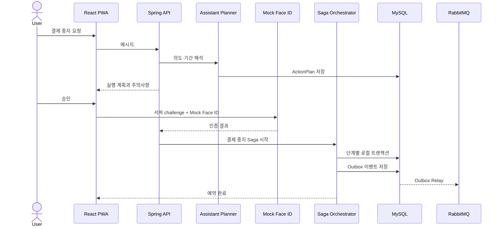

# Woonie MVP Architecture

## 핵심 원칙

1. 사용자의 구독마다 내부 지갑과 가상카드를 하나씩 연결한다.
2. 평소에는 결제 예정일에 맞춰 지갑을 JIT 방식으로 자동 충전한다.
3. 결제 중지 기간에는 자동 충전과 가상카드를 중지한다.
4. AI는 조회와 `ActionPlan` 생성까지만 담당한다.
5. Mock Face ID 인증이 끝난 뒤 결정론적인 Saga가 작업을 실행한다.

## 실행 흐름



## Saga 단계

```text
REQUESTED
→ AUTO_FUNDING_DISABLE_SCHEDULED
→ VIRTUAL_CARD_PAUSE_SCHEDULED
→ RESUME_SCHEDULED
→ COMPLETED
```

시작일이 오늘이면 예약 단계 대신 지갑과 가상카드를 즉시 중지한다. 실패 시 이전 단계에서
변경한 지갑 설정을 복구하고 Saga를 `FAILED`로 기록한다. 모든 단계는
`sagaId:stepType`을 멱등 키로 사용한다.

## 프로파일

- `local`: H2, RabbitMQ 비활성화, Mock Face ID, 규칙 기반 Assistant
- `docker`: MySQL과 RabbitMQ 활성화
- `google-oidc`: Google OAuth2 Login 활성화
- `openai`: Spring AI OpenAI 모델 활성화

조합 예시:

```bash
./apps/api/gradlew -p apps/api bootRun \
  --args='--spring.profiles.active=docker,google-oidc,openai'
```

## API 계약

Springdoc이 `/v3/api-docs`에 OpenAPI JSON을 만든다. 프론트엔드는 Orval로 타입과
TanStack Query 코드를 생성한다.

```bash
pnpm api:generate
```

Apidog에서는 `/v3/api-docs` URL을 Scheduled Import 원본으로 연결한다.

## 운영 전 교체 대상

- `MockFaceIdAuthenticationAdapter` → WebAuthn 또는 우리금융 인증 어댑터
- 규칙 기반 `AssistantService` → Spring AI 구조화 출력 어댑터
- 가상카드 상태 변경 → 실제 카드 발급·승인 시스템 포트
- Demo customer → Google OIDC `sub`와 내부 고객 식별자 연결
