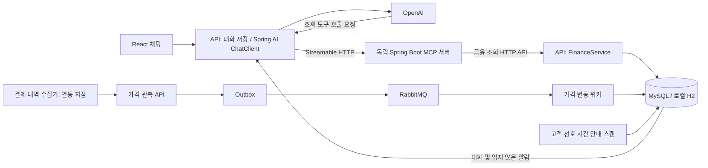

# 카드·구독 MCP 상담 아키텍처

## 역할

`apps/api`는 JPA 저장, 데이터 계산, 고객 대화, Spring AI와 MCP Client를 담당합니다. `apps/mcp`는 DB에 직접 접근하지 않고 `/api/finance/*` 조회 API를 도구로 노출합니다. OpenAI가 요청한 도구는 API의 `SyncMcpToolCallback` 어댑터가 독립 MCP 서버에 호출합니다.

MCP 도구는 13개로 제한합니다. `get_subscriptions`, `explain_merchant`, `get_payment_readiness`, `get_price_changes`, `find_subscription_overlaps`, `get_renewal_alerts`, `get_cancellation_summary`, `get_usage_analysis`, `recommend_cards`, `get_customer_context`, `get_card_schedule`, `get_financial_alerts`, `get_payment_failure_policy`입니다. 모두 읽기 도구이며 캘린더·금융 실행 도구는 없습니다. 정책 도구는 조사일이 있는 참고 스냅샷입니다.

## 대화와 외부 호출

사용자 메시지에서 고객 ID를 받지 않고 현재 데모 고객을 서버가 정합니다. 최근 메시지 20개를 LLM 문맥으로 전달하며, 현재 금액은 매 요청의 MCP 도구 결과로 다시 확인하도록 지시합니다. DB 트랜잭션을 종료한 뒤 외부 모델·MCP를 호출하고, 응답 성공 시 사용자·상담 메시지를 함께 저장합니다. 외부 실패 시 가짜 답변을 저장하지 않습니다.

MCP는 첫 호출에 초기화합니다. 허용된 읽기 도구만 모델에 전달하고, 요청당 도구 호출 12회·도구 인자 8000자·응답 4000자 상한과 시간 예산을 둡니다. OpenAI/MCP 오류는 `503 ASSISTANT_UNAVAILABLE`로 응답하며 프론트에 입력을 복원합니다. API 로그나 응답에 키를 출력하지 않습니다.

## 계산과 사실 확인

- 월간·연간 구독을 월 환산액으로 구분하고, 카드 혜택 예측은 실제 청구 주기의 향후 1년 지급 월별로 계산합니다. 연간권에 매달 할인을 적용하지 않습니다.
- 전월실적·상태·할인한도·사용한 한도·연회비·연령·거주지·직업 조건을 반영합니다. 미래 실적 달성, 카드사 발급 심사, 미연동 실제 약관은 미확인입니다.
- 원통화 금액 변화와 환율/수수료에 따른 원화 증가를 구분합니다. 원통화 증거가 없는 가격 관측은 인상 확정으로 취급하지 않습니다.
- 결제 거절은 계약 해지로 간주하지 않습니다. 계약 확인일과 해지 이후 승인 내역을 함께 봅니다.
- 이용 횟수가 없으면 사용하지 않는다고 판단하지 않습니다. 1회권 가격이 있는 샘플 멤버십만 손익분기 횟수를 계산합니다.
- 또래 비교는 명시적으로 가상 집계 데이터이며 실제 고객 통계가 아닙니다. 성별·원시 소득·고객 생년월일을 도구 결과에 반환하지 않습니다.

## 알림

가격 관측은 MySQL 프로파일에서 Outbox + RabbitMQ 워커로 처리합니다. 관측 ID와 메시지 사건 키로 중복을 방지하고, 오래된 관측은 현재 상태를 덮어쓰지 않습니다. 로컬 H2는 같은 처리 서비스를 직접 호출합니다.

기타 무료체험·갱신·결제 예정·카드 결제일·만료·포인트·연회비 알림은 시간마다 확인하여 고객 선호 시간에 DB 채팅에 저장합니다. `/api/internal/finance-alerts/scan`은 샘플 데이터 환경의 수동 확인 경로입니다. 기기 푸시, 캘린더 저장, 금융 거래는 연결하지 않았습니다.

## 프로파일

- `local`: H2 메모리 DB, 규칙 기반 상담. 샘플 데이터를 직접 확인할 수 있습니다.
- `docker`: MySQL + RabbitMQ. 상담 생성 방식은 규칙 기반입니다.
- `local,openai` / `docker,openai`: Spring AI + OpenAI + 독립 MCP 서버로 상담합니다.

OpenAI API 키는 API 프로세스 환경변수만 사용합니다. MCP는 키가 필요하지 않습니다. 현재 모든 금융 데이터와 고객 범위는 데모용이며 실서비스의 인증·권한·외부 공급자 어댑터는 후속 연동 대상입니다.
